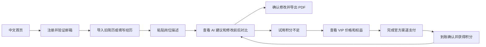
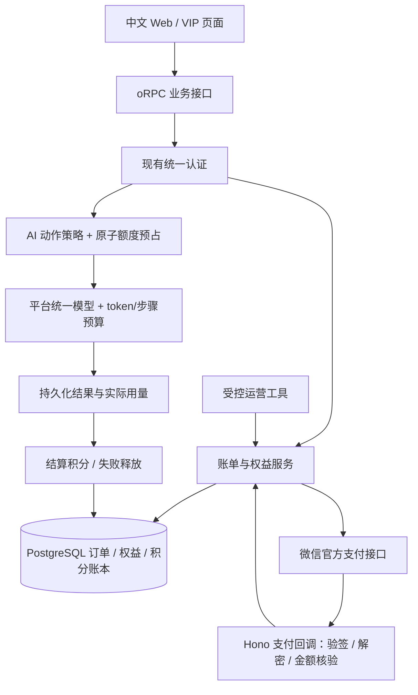

# 中文 AI 简历产品：快速上线与付费 VIP 计划

> 计划日期：2026-10-12。首发市场：中国大陆。当前无收款渠道。
> 推荐：复用 Reactive Resume，首发聚焦「中文简历润色、岗位定制、PDF 导出」，增加一个预付 30 天 VIP 套餐。
> 开发目标：1 名熟悉 TypeScript 的全栈开发者配合 AI 工具，约 20–30 个工作日完成付费候选版本；按逐功能分支与 PR 集成要求重新估算，审批、主体申请及等待评审时间另计。
> 本次交付为方案与评审画布。确认方案不自动提交商户申请、购买资源、启用真实收款或发布生产环境；实施可从第一阶段开始。

## 1. 首发定位与成功标准

**首发用户假设：有旧简历、正在投递的中文求职者，先聚焦 1–5 年工作经验的互联网与办公岗位。** 应届生专属流程作为后续扩展，避免第一版同时覆盖所有人群。

核心承诺：「导入经历，贴入岗位描述，得到可审核、可编辑的中文简历建议，并导出清晰 PDF。」页面上的时间、效果与通过率宣传，需要真实测量后才能使用。

最短用户流程：

第一轮目标是验证用户愿意为「中文内容质量和岗位适配」付费。免费保留基础编辑和 PDF 导出，让用户能够完成体验。

| 首发验收指标 | 初始门槛或验证方式                                                           |
| ------------ | ---------------------------------------------------------------------------- |
| 中文输出质量 | 至少 20 份虚构或获授权的脱敏简历、10 份岗位描述；事实、数字、日期无凭空新增  |
| 中文 PDF     | 姓名、联系方式、长中文段落、中英混排、两页简历正常显示；复制文本与源内容一致 |
| 使用闭环     | 新用户可独立完成注册、试用、确认修改、导出、购买、继续使用                   |
| 支付正确性   | 重复通知、金额篡改、漏通知、退款、过期订单等测试通过；权益只发放一次         |
| 成本可控     | 有每次 AI 成本、账户积分、日总预算和暂停付费 AI 的开关                       |
| 首轮商业验证 | 邀请 20–30 位真实目标用户；统计完成率、满意度和自愿购买人数，不预设收入保证  |

## 2. 当前代码能复用什么

基于本地代码检查：版本 `6.0.2`，MIT 许可，中文语言包、中文字体回退、17 套模板、账号体系、AI 服务和文档编辑已存在；未发现现成的订单、支付、会员或积分业务模块。

| 领域              | 现有位置                                                                          | 首发处理                                       |
| ----------------- | --------------------------------------------------------------------------------- | ---------------------------------------------- |
| 简历编辑、预览    | `apps/web/src/routes/builder/$resumeId`、`apps/web/src/features/resume`           | 复用编辑器，整理中文入口和文案                 |
| 中文语言包        | `apps/web/locales/zh-CN.po`、`zh-TW.po`                                           | 默认简体中文，核对关键流程翻译                 |
| PDF 与中文字体    | `packages/pdf`、`packages/fonts`                                                  | 复用渲染，精选 3–5 套适合中文的模板            |
| 登录和邮箱        | `packages/auth/src/config.ts`                                                     | 首发邮箱登录；AI 试用积分仅在邮箱验证后发放    |
| 共享 AI 服务      | `packages/api/src/features/ai-providers/service.ts`、`packages/env/src/server.ts` | 配置一个平台管理的模型，用户无需填写 API Key   |
| 润色和审查        | `packages/api/src/features/ai`                                                    | 复用调用与结构化输出，调整中文提示词和事实约束 |
| AI 建议、岗位定制 | `packages/api/src/features/agent`、`applications/ai.ts`                           | 保留修改建议审核能力；收敛为几个明确动作       |
| Web/API 连接      | `packages/api/src/routers/index.ts`、`apps/server/src/http/app.ts`                | 新增账单接口与支付回调适配器                   |
| DB 与部署         | `packages/db`、`migrations`、生产 Docker                                          | 新增账单表；沿用现有单进程部署架构             |

当前工作区没有 `node_modules`、`.env.local` 或 `.env`，尚未验证启动。第一阶段必须先建立能运行、能构建的基线。

环境以实际文件为准：Node.js `24.x`、根 `packageManager` 当前为 `pnpm@12.11.2`，与旧说明中的版本有差异。

## 3. MVP 范围：把开发量压在能收费的闭环上

| 优先级 | 首发内容                                         | 完成定义                                                            |
| ------ | ------------------------------------------------ | ------------------------------------------------------------------- |
| P0     | 自有品牌、中文首页、价格页                       | 首页说明真实权益、价格、主体与客服；中文 URL/SEO 按现有生产路由处理 |
| P0     | 中文简历编辑与 PDF                               | 精选模板、默认字体、中文字段示例；可编辑、保存、导出                |
| P0     | AI 经历润色                                      | 单段操作、事实保留、前后对比、用户确认                              |
| P0     | AI 简历审查                                      | 可执行建议与依据；区分确定性检查和 AI 评价                          |
| P0     | 按岗位定制                                       | 粘贴 JD，输出建议而非自动覆盖；不新增未经确认的经历和技能           |
| P0     | 试用积分、VIP、订单                              | 余额和到期时间清晰；操作前展示扣减；购买后可查询订单                |
| P0     | 一个官方支付渠道                                 | 创建订单、付款、验签、权益发放、查单补偿、退款记录完整              |
| P0     | 基础运营与隐私                                   | 后台受控操作、成本监控、告警、数据删除、隐私与退款说明              |
| P1     | 求职信、DOCX AI 导入                             | 既有能力后续开放，先接入统一计费和中文质量验证                      |
| P1     | 手机便捷支付、积分加购                           | 在主体与支付产品权限确认后扩展                                      |
| P2     | 职业教练、语音面试、自动岗位搜索                 | 首发导航收起，并在服务端关闭相应付费模型入口                        |
| P2     | 年费、自动续费、优惠券、邀请返利、团队版、小程序 | 有真实付费数据后再做                                                |

**首发公开产品只开放已做权益校验和积分核算的 AI 动作。** 现有通用聊天、后台定时 AI、语音、API/MCP 等能力，按商业版配置禁用或纳入同一服务端策略；只隐藏按钮不能防止绕过。

PDF 下载主要在浏览器完成。首发不对基础 PDF 下载收费，不增加难以执行的浏览器下载次数限制，也不提供付费无限 AI。

## 4. 推荐套餐：一个 SKU，先验证付费

以下为待验证的产品定价建议，不是现有项目功能，也不是已测得的单位成本。

| 权益                         | 免费版                                        | VIP 30 天                             |
| ---------------------------- | --------------------------------------------- | ------------------------------------- |
| 定价                         | ¥0                                            | **¥39 / 30 天**，一次支付，不自动续费 |
| 简历编辑、精选模板、PDF 导出 | 可用                                          | 可用                                  |
| 确定性简历检查               | 可用                                          | 可用                                  |
| AI 积分                      | 验证邮箱后赠 5 积分，每账号仅一次，7 天内有效 | 每个 30 天权益周期 150 积分           |
| AI 润色、审查、岗位定制      | 按试用积分消耗                                | 按积分消耗                            |
| 付费信息                     | 展示试用余额                                  | 展示周期、余额、订单、到期时间        |
| 到期后                       | 保留简历与基础功能                            | 回到免费权益；该周期未用积分到期失效  |

首发不拆多档套餐。若首轮访谈显示价格阻力，再试验 ¥29；每笔订单保存下单时的价格与权益快照，旧订单不随改价变化。

### 积分规则

| 动作             | 建议扣分 | 输入与输出边界                         |
| ---------------- | -------- | -------------------------------------- |
| 单段经历润色     | 1        | 一段经历，限制输入长度与输出 token     |
| 一次简历审查     | 3        | 一份简历；超长内容提示先精简           |
| 一次岗位定制建议 | 5        | 一份简历 + 一份 JD；限制总长度与建议数 |

积分是产品额度，token 成本另记。一次点击可能触发多个模型步骤，只有在总步数、重试次数和 token 上限都明确后，才能固定收取上述积分。

- 操作前展示本次所需积分；余额不足时提示购买，不发送模型请求。
- 服务器原子预占积分，生成成功且结果已持久化后结算。
- 模型失败或结果未成功保存时释放预占；取消或断连也记录实际模型成本，不能丢失费用数据。
- 刷新后可以找回已保存结果，同一请求 ID 不重复生成、不重复扣分。
- 首发不对通用无限聊天承诺固定低积分；未完成预算控制的入口不开放。
- 每周期 150 积分，是总额度；不是「每个动作 150 次」。

### 续费与退款边界

- 提前续费接到当前权益周期之后，下一周期积分到生效日才可用；页面明确展示生效日期。首发最多保留一个待生效周期。
- 每个订单对应独立权益周期、独立积分批次，便于到期、对账和退款；试用积分单独记账。
- 扣减先用即将到期的可用积分；过去和未来的批次不参与当前余额。
- 已支付订单只在服务端确认后生效；待支付订单不占用未来权益周期。
- 退款先走受控客服/运营流程，按经确认的适用规则执行。首发不开发复杂自助退款 UI，也不使用笼统的「一经购买概不退款」。
- 未使用、未生效周期可按已公示规则处理全额退款；已生效或已使用订单由客服核对消费记录与适用规则。
- 支付渠道确认退款成功后撤销对应剩余积分和权益，保留账本与审计；退款中的权益按明确策略冻结，不能既全额退款又继续使用。
- 首发不实现自动续费、不支持多月堆叠购买或积分包；这些能力后续按数据决定。

## 5. 收款渠道申请：从今天并行启动

**默认首发采用微信 Native 扫码支付，面向桌面网页购买。** 简历编辑以电脑为主，先打通一个渠道，开发和商户配置最少。手机端第一版可查看权益和编辑简历，购买页面明确提示在电脑上扫码；手机便捷购买放下一阶段。

微信官方说明 Native 权限支持企业和个体工商户等主体；H5 支付与 Native 是不同产品权限，当前官方权限表不支持个体工商户申请 H5。因此，主体未明确前不能把「微信手机 H5 支付」承诺为首发功能。[Native 开发准备](https://pay.wechatpay.cn/doc/v3/merchant/4015614538)、[主体支付权限表](https://pay.wechatpay.cn/doc/v3/merchant/4015616699)。

| 步骤              | 你/运营准备什么                                                | 工程并行做什么                             | 通过标志                       |
| ----------------- | -------------------------------------------------------------- | ------------------------------------------ | ------------------------------ |
| 1. 确认经营主体   | 确认已有企业或个体工商户；没有则办理，核对业务与许可适用性     | 用测试配置开发，不收真实款                 | 主体、负责人和经营类目明确     |
| 2. 准备产品与域名 | 自有品牌、域名、业务说明、套餐和售后方式                       | 完成可展示的产品与价格说明页               | 网站可审查，主体与产品信息一致 |
| 3. 商户进件       | 营业执照、负责人证件、结算账户、网站与类目材料，按平台清单提交 | 支付适配层、订单表、回调验证、模拟通知     | 商户审核通过，结算账户有效     |
| 4. 开通 Native    | 确认 AppID、商户绑定和产品权限；核对虚拟服务类目支持情况       | HTTPS 回调、支付公钥/证书、API v3 密钥配置 | 产品权限可实际下单             |
| 5. 联调与对账     | 核对客服、退款说明和结算规则                                   | 经授权的真实小额交易、退款、查单与日对账   | 金额、订单、权益、退款全部对应 |
| 6. 正式放量       | 确认上线所需手续完成                                           | 移除测试开关，分批开放                     | 发布门槛全部通过               |

申请耗时受主体、业务类目、资料补充和审核影响，计划不承诺固定通过天数。商户未通过期间，内部验收使用支付模拟器和官方允许的测试方式。

若 Native 申请不适合最终主体/场景，再评估支付宝官方网站支付；按其当前产品准入要求重新排期。个人收款码不能作为自动订单支付闭环。

## 6. 大陆公开上线的前置工作

这些事项直接影响「能否正式公开收费」，与功能开发并行推进。不要把开发完成日期等同于公开上线日期。

| 前置事项           | 首发动作                                                                                                                  | 负责人/依据                                                                                                                                                                                 |
| ------------------ | ------------------------------------------------------------------------------------------------------------------------- | ------------------------------------------------------------------------------------------------------------------------------------------------------------------------------------------- |
| 域名与网站资质     | 通过云服务商办理适用的网站备案；付费模式另向所在地主管部门/专业顾问确认经营性许可适用性与主体条件                         | 运营；经营性许可与非经营性备案是不同制度，不能视为已备案即可收费。[工信部管理办法](https://www.miit.gov.cn/datainfo/fgk/gytxyxxhfg/xzfg/art/2020/art_44595811ff9a42b9b073386046905103.html) |
| 国内模型与应用登记 | 首发接一个满足目标市场要求的已备案模型服务；向地方网信部门核实并完成适用的应用/功能登记与公示                             | 运营 + 工程；已备案模型 API 应用/功能有地方登记路径，调用该 API 不等于产品手续已完成。[网信办 2026 年公告](https://www.cac.gov.cn/2026-09/14/c_1791136833136332.htm)                        |
| AI 内容标识        | 明确生成建议、采纳内容、复制和 PDF/DOCX 导出的适用显式/隐式标识方案；完成导出元数据与内容来源验证，不能只在聊天框加提示   | 工程 + 运营；规则覆盖交互、生成文件与导出，按具体适用情形确认实现。[标识办法](https://www.cac.gov.cn/2025-03/14/c_1743654684782215.htm)                                                     |
| 简历隐私           | AI 调用前说明用途与模型服务商；仅发送任务必要字段，姓名、电话、邮箱、详细地址原则上不传模型；日志不保存全文和个人联系方式 | 工程 + 运营                                                                                                                                                                                 |
| 用户与售后说明     | VIP 价格、期限、积分规则、到期、续费与退款说明清楚；提供经营主体、客服与订单凭据，确认发票处理方式                        | 运营                                                                                                                                                                                        |

个人身份是否能承载最终收费和资质路径，必须先确认。如果需要企业主体或许可，时间表随之调整。海外部署不作为规避上述适用要求的上线捷径。

标识实现若影响 PDF 版面，按最终适用方案处理；「无商业推广水印」不能被写成「无 AI 内容标识」的承诺。

## 7. 技术实施：权益与支付放在服务端

保留现有 monorepo、Hono、oRPC、Drizzle 与 PDF 架构。首发新增账单领域，避免另起微服务或重写编辑器。

### 建议新增与修改位置

| 位置                                                                               | 工作内容                                                               |
| ---------------------------------------------------------------------------------- | ---------------------------------------------------------------------- |
| `packages/db/src/schema/billing.ts`                                                | 订单、支付事件、权益周期、积分批次、AI 请求/预占、积分账本             |
| `packages/api/src/features/billing`                                                | DTO、订单服务、价格/权益策略、幂等处理、退款与对账业务                 |
| `packages/api/src/routers/index.ts`                                                | 聚合 billing 路由；认证继续用现有 `protectedProcedure`                 |
| `apps/server/src/http/payments.ts`                                                 | 保存原始请求体、验证回调签名/解密、交给业务服务；HTTP 层不独立发权益   |
| `apps/server/src/http/app.ts`                                                      | 挂载回调与必要的健康/访问控制处理                                      |
| `packages/api/src/features/ai`、`agent`、`applications`、`cover-letters`、`career` | 明确逐个模型入口的动作策略、权限校验、额度与预算；未开放入口服务端拒绝 |
| `apps/web/src/features/billing`                                                    | 套餐、积分余额、付款、订单与到期提示                                   |
| `apps/web/src/routes/dashboard/settings`                                           | 新增会员/账单页面；由路由生成器生成路由树                              |
| `apps/web/src/features/homepage`、营销路由及服务端静态 SEO                         | 品牌、中文首页、价格页；生产 HTML 路由与 SEO 一并验证                  |
| `packages/ai/src`、`apps/web/locales/zh-CN.po`                                     | 中文提示词、术语、动作提示和错误文案                                   |
| `packages/env/src/server.ts`、`.env.example`、`turbo.json`                         | 同步声明支付配置、商业功能开关、模型预算和任务环境白名单               |
| `tooling/billing`                                                                  | 最小受控查单、对账、退款/补偿工具；操作留审计，不首发通用管理后台      |
| `docs/guides`、`docs/self-hosting`                                                 | 更新用户可见的中文付费、AI 与部署说明；职业功能变更遵守映射文档要求    |

### 最小数据模型

| 表/实体              | 必要字段与不变量                                                                                               |
| -------------------- | -------------------------------------------------------------------------------------------------------------- |
| `billing_orders`     | 用户、SKU/价格/权益快照、金额（整数分）、币种、商户订单号、渠道交易号、订单状态、支付/退款时间；商户订单号唯一 |
| `payment_events`     | 渠道事件/交易标识、处理状态、必要脱敏摘要；重复成功通知只能处理一次                                            |
| `membership_periods` | 用户、来源订单、生效/到期时间、状态；来源订单唯一；同用户周期串行分配                                          |
| `credit_grants`      | 用户、来源订单或试用资格、原始额度、已消费/预占、有效时间；每订单和每账号试用发放各有唯一约束                  |
| `ai_requests`        | 用户、动作、幂等请求 ID、预占积分、结果引用、状态、token、实际模型成本；同用户请求 ID 唯一                     |
| `credit_ledger`      | 发放、预占、结算、释放、到期、撤销；关联订单/请求与操作原因；不可直接覆盖历史记录                              |

不只在 `user` 上增加 `isVip`。VIP 到期、提前续费、退款和并发请求都需要可追踪的权益记录。

### 支付正确性要求

1. 金额、币种、SKU 与权益在服务端确定；客户端只提交 SKU，不能指定开通天数或积分。
2. 创建订单带幂等键，并复用仍有效的待支付订单，避免双击创建多笔未付订单。
3. 成功回调验证签名、解密数据、商户/AppID、渠道交易状态、订单金额与币种；返回页仅展示查单结果，不发权益。
4. 在数据库事务中把订单改为已支付、发放对应权益和积分；通知事件、订单发放、积分发放均有唯一约束。
5. 回调只在持久化处理完成后确认；重复、延迟、乱序通知不得重复开通或覆盖退款终态。
6. 查单补偿与日对账复用同一处理函数。回调漏到时查询渠道补齐，不让客服直接无记录地改余额。
7. 本地订单过期要请求渠道关单，并查询竞争结果；若支付与关单竞争，按渠道已确认的真实结果发权益或按已公示规则退款。
8. 同用户并发购买时对权益分配加锁，拒绝超过一个待生效周期；金额与时间判断以服务端/渠道为准。

### AI 额度正确性要求

1. 在业务动作入口鉴权并原子预占；单纯在 provider getter 里扣分不可靠，因为一次动作可能多次取 provider。
2. 全部商业模型调用有统一策略；API/MCP、后台任务不能绕过。平台 Key 只在服务端使用。
3. 数据库是账本事实来源，Redis 负责共享频控、并发与短期锁；不能以易丢失的 Redis 余额为唯一依据。
4. 预占、生成、保存、结算有稳定状态与重试键。进程崩溃后的预占由补偿任务按请求状态处理。
5. 流式请求中止、工具多步、继续生成、自动重试有明确预算，记录全部实际用量；结果被重复读取不再扣分。
6. 输入限制、输出 token、工具步数、单用户并发、单日额度及全站日预算一起限制成本。
7. 超全站预算或模型异常时停止新 AI 任务；现有编辑、订单查询和基础导出继续可用，用户得到明确提示。

## 8. 中文 AI 与产品体验

首发接一个国内可用、满足上线要求的模型服务，以 `AI_PROVIDER`、`AI_MODEL`、`AI_API_KEY`、必要时 `AI_BASE_URL` 配置共享模型。现有服务已支持平台管理模式；用户不需要了解模型名称或填 Key。

提供三个产品动作：「润色这段经历」「检查我的简历」「按这个岗位调整」。模型、调用参数、token、provider 配置留在管理与日志界面，用户只看到用途、扣分与结果。

提示词和输出约束：

- 中文简历以「动作—职责—结果」表达经历，缺失结果时提出补充问题。
- 不编造项目规模、提升百分比、职位、教育、日期或证书；原文数字保留。
- JD 匹配区分「经历有证据」「相关经验」「尚未提供证据」，不能把关键词填充包装成真实经验。
- JD 与简历内容作为资料，不作为模型指令；模型修改经现有 Zod/补丁约束与用户确认。
- AI 审查不自造第二套 ATS 分数，也不承诺通过某招聘系统；确定性报告与写作建议分开展示。
- 自动遮蔽对该动作无必要的姓名、电话、邮箱、地址；结果仍可在原文档合并。
- 中文日期、标点、段落长度与中英技术词统一；保留英文职位和技术名的准确写法。

首发不新增渲染引擎。对既有中文字体做字体文件部署检查和真实 PDF 检验，避免只看浏览器预览。

## 9. 20–30 个工作日实施顺序

原 12–15 工作日是粗粒度候选版本估算。按每功能独立分支、PR、依赖合并与验收的新要求，改用 20–30 工作日工程预算，详细拆分见 [模块化开发计划](chinese-ai-resume-development.plan.md)，实际状态见 [功能跟踪表](chinese-ai-resume-feature-tracker.md)。下表以 30 工作日预算展示；审批申请由你/运营同步推进。若基线构建失败或标识要求需要额外适配，重新估算，不能跳过验收压缩时间。

| 阶段          | 预计时间 | 工程交付                                                                              | 同步业务动作                                    | 退出标准                                               |
| ------------- | -------- | ------------------------------------------------------------------------------------- | ----------------------------------------------- | ------------------------------------------------------ |
| S0 基线       | D1–D3    | 安装锁定依赖、隔离测试数据库、运行现有应用、一次基线构建；建立 dev CI 与 staging 基础 | 确定主体、品牌/域名、许可咨询；商户材料清单     | 登录、编辑、导出跑通，记录基线缺陷                     |
| S1 中文核心   | D4–D7    | 中文首页/核心文案、精选模板、统一模型与中文质量样本；暂仅内部测试                     | 提交适用备案/登记材料；准备价格、隐私与售后说明 | 中文基础编辑和 PDF 合格；AI 样本质量有记录             |
| S2 权益与积分 | D8–D15   | billing 表与迁移、试用发放、VIP 周期、原子预占与结算、三个 AI 动作；关闭未计费入口    | 确认首发价格与积分成本，处理商户补件            | 并发、重试、断连、到期、中文动作与试用重复领取测试通过 |
| S3 支付闭环   | D16–D21  | Native 订单、回调、查单、退款补偿、账单页面、运营脚本；审核未通过则测试配置联调       | 申请 Native 权限、确认商户/AppID 与结算         | 支付/发放幂等、金额校验、漏回调恢复测试通过            |
| S4 上线验收   | D22–D26  | 生产构建、E2E、导出标识、访问速度、备份恢复、用量监控、中文部署与操作说明             | 核对网站/AI手续、客服与退款流程                 | 无首发验收阻断，支付成本与用户数据处理可追踪           |
| S5 小规模发布 | D27–D30  | 手续齐备后开放 20–30 人试用，分批真实付费，修复反馈                                   | 用户招募与客服、授权小额收款和退款验收          | 核心体验与真实支付均通过，才扩大流量                   |

**正式公开收费时间 = 开发验收、经营主体/网站手续、AI 手续、支付权限就绪时间中的最晚一项。** 不是固定 D30。

若审批滞后：继续内部质量测试、支付模拟测试和候选用户访谈；必要时在适用手续确认后先发布基础编辑产品。付费 AI 与真实收款开关保持关闭，避免售卖尚不能交付的权益。

## 10. 部署与成本方案

默认复用生产 Docker，部署到大陆合适区域，先一套应用 + PostgreSQL + Redis + 上传/字体资源存储。数据库和模型尽量同区域或低延迟接入，配置 HTTPS、SMTP 和自动备份；有合适现成托管数据库时优先使用。

首发只需生产与 staging 两个隔离环境。付款商户配置、AI Key、数据库和简历数据各自隔离；没有多区域、Kubernetes 或新微服务需求。迁移先在 staging 演练，生产先备份，不重置数据库或删除存储卷。

| 预算项                         | 首月准备额度（估算，不是供应商报价）                    |
| ------------------------------ | ------------------------------------------------------- |
| 应用、数据库、存储、邮件、监控 | ¥300–1,000，根据托管/自建、地域、并发与备份选型重新报价 |
| AI 测试额度                    | ¥200–500，先设硬预算并跑质量/成本样本                   |
| 域名与经营/审批准备            | 单独列支；主体、资质、人工和审核成本未纳入上述运行费用  |
| 收款手续费                     | 按获批类目和实际合同核算，不预设固定费率                |

**成本验算先于最终定价。** 定义 `c` 为各种动作按积分折算的实测平均 AI 成本，满额使用的单用户 AI 成本为 `150 × c`。

例如仅作为测算：若 `c = ¥0.05/积分`，150 积分成本约 ¥7.50，占 ¥39 收入约 19.2%。这不是已测得成本，也未包含支付、客服、基础设施、税费与获客支出。若测试结果明显高于此预算，优先调整模型/动作 token 与额度，然后再决定价格。

要同时测量平均与高消耗场景。给重试、用户取消、模型多步失败留成本空间；不能用最短一次润色的价格代表全量岗位定制成本。

## 11. 必须完成的测试和发布门槛

账单与积分涉及资金，新增有意义的单元与数据库集成测试；中文静态文案不用写镜像实现的测试。

| 类别       | 必测场景                                                                         |
| ---------- | -------------------------------------------------------------------------------- |
| 订单       | 双击下单、幂等重试、客户端价格篡改、查询他人订单、未付款跳转成功页               |
| 回调       | 签名失败、解密失败、商户/AppID 不匹配、金额/币种不匹配、重复和乱序通知           |
| 补偿       | 漏通知、查单恢复、支付与关单竞争、回调事务失败重试、进程重启后的处理             |
| 权益       | 单笔只发一次、并发续费、到期边界、下一周期额度、最多一个待生效周期               |
| 积分       | 试用重复领取、并发透支、余额不足、生成失败、断连取消、结果重复读取、崩溃预占恢复 |
| 退款       | 重复请求、退款失败/处理中/成功、关联订单撤销、未来周期撤销、消费记录保留         |
| 入口封锁   | 直接调用未开放 AI/API/MCP、后台任务使用共享模型、超预算后继续发请求              |
| 中文与隐私 | 中英文 PDF、长段落分页、字体加载、脱敏输入、日志无全文/联系方式、适用 AI 标识    |

实施时至少完成：相关包 typecheck/test；代码变更后运行指定路径的 `oxlint --fix` 和 `oxfmt`；结束前执行 `pnpm lint:agent`、`pnpm format:check`；共享契约/导出变化执行 boundaries；运行/打包变化执行生产 build；支付+AI+导出核心流程跑隔离数据库下的浏览器 E2E。

安装依赖后，变更 Turborepo 配置或命令前先读安装版本的 bundled docs。新增环境变量同步 env 校验、模板、Turbo 透传与测试 env。涉及新用户文案运行 Lingui 提取与 PDF 翻译生成；新公共 API 更新生成文档。

真实小额支付与退款只在商户和渠道准备完成、获得明确授权后执行；本计划不调用真实商户账户。

## 12. 首批运营与第二阶段

先找 20–30 位正在真实求职的人，观察他们用自己的简历完成闭环；公开演示和截图只使用虚构材料或获授权脱敏内容。首页先展示 3 组中文改写对比，不增加大量模板或复杂会员营销。

记录事件：注册完成、邮箱验证、导入成功、AI 动作开始/成功/失败、建议采纳、PDF 导出、价格页访问、订单创建、支付确认、退款。事件仅记录 ID、动作、状态与金额，不能夹带简历正文和个人联系方式。

每周看四个问题：

1. 用户是否完成一次满意的修改并导出？
2. 试用积分不足后，价格页和支付环节是否顺畅？
3. 哪个 AI 动作最常被采纳，哪个消耗成本却没有价值？
4. 退款/客诉来自内容质量、权益解释还是支付故障？

第二阶段按数据排序：手机便捷支付 → 更合适的积分包 → 求职信/Word 导入 → 应届生或特定行业提示词 → 更多职业功能。年费和自动续费至少等一个完整付费周期后再评估。

## 13. 本版决策与待完成项

| 项目             | 本版状态                                                                     |
| ---------------- | ---------------------------------------------------------------------------- |
| 市场             | 已确认：中国大陆中文用户                                                     |
| 支付现状         | 已确认：无收款渠道，计划包含商户申请                                         |
| 首发定位         | 建议：有旧简历、正在投递的 1–5 年经验求职者                                  |
| 价格与积分       | 建议：¥39/30 天、150 积分；验证邮箱送 5 积分；以实测成本再确认               |
| 首发支付         | 建议：微信 Native，电脑扫码；H5/其他渠道下一阶段                             |
| 开发规模         | 估算：1 名全栈开发者，20–30 个工作日；逐功能 PR 集成，审批与等待评审时间另计 |
| 经营主体         | 待你/运营确认：企业、个体或尚未办理；不同路径影响许可与支付                  |
| 品牌/域名/云资源 | 待选，不阻塞本地功能开发；阻塞生产申请与发布的部分应在 D1 启动               |
| 模型服务         | 待选并验证：国内接入、备案/登记路径、质量、延迟、成本、数据条款              |
| 首个实施步骤     | 建立可运行基线，记录现有缺陷，再接共享 AI 和中文核心流程                     |

评审时可直接批注价格、积分、首发支付、时间表或目标用户。后续实施优先 S0/S1；公开发布与真实收款仍须完成相应前置事项。
